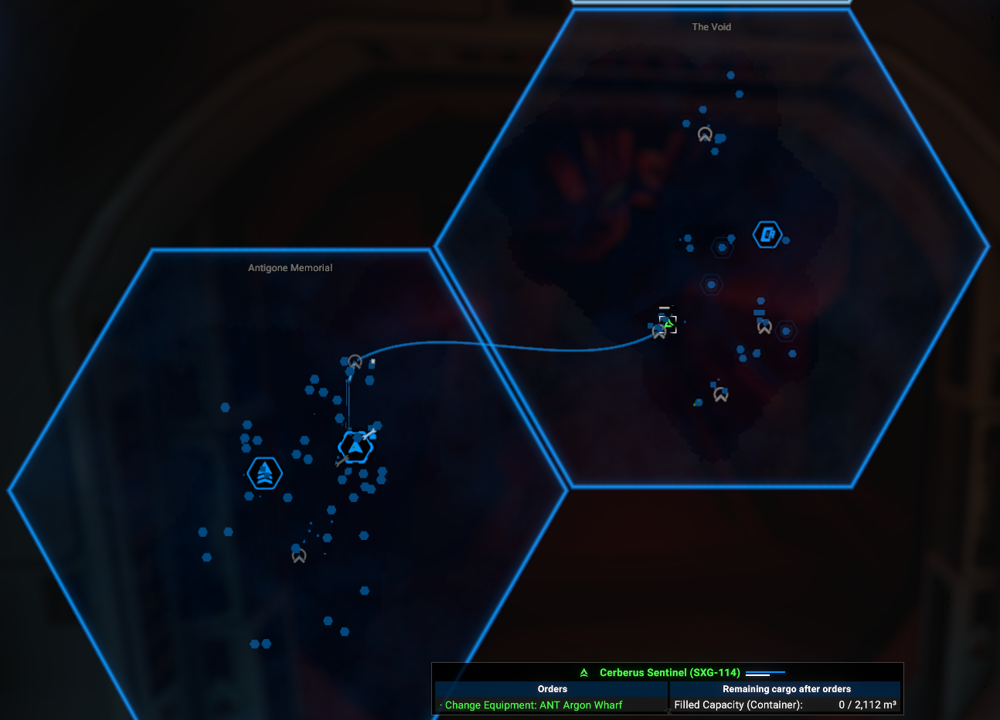
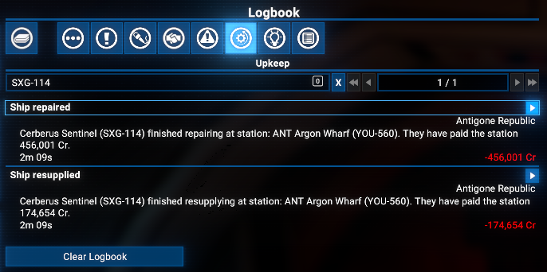
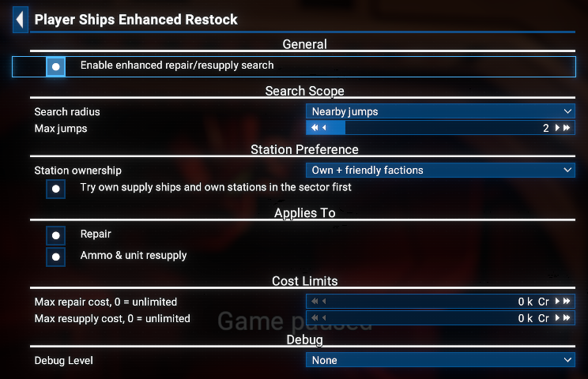

# Player Ships Enhanced Restock

Lets player-owned ships repair and resupply beyond their own sector and beyond player-owned stations, with configurable search range, station ownership preference, need-type filters, and cost limits via Extension Options.

## Features

- The game restricts the automatic repair and resupply search of player-owned ships to their own stations in their current sector (supply ships of the fleet are tried first). This mod widens that search according to your settings.
- **Search Scope**: sector only, nearby jumps (a configurable number of jumps), or the whole known galaxy.
- **Station Preference**: own stations only, own + friendly factions, or any non-hostile known station.
- **Try own first**: when on, a station found by the wider search is used only if no own supply ship or own station in the sector can do the job; when off, the closest candidate wins. An own supply ship that is not on supply duty is never used by the game and does not count.
- When the ship needs ammunition, stations able to build all of it are used first; a nearer station that lacks a missile type is considered only when no station has them all.
- **Applies To**: independent switches for repair and for ammo and unit resupply. A need that is switched off is not served at a station found by the wider search, even when the ship goes there for the other need.
- **Paid service**: at a station of another faction the ship pays the station's price for the repair and for the ammunition and units it takes. Each payment is written to the logbook (Upkeep). Service at your own stations stays free, as in the base game.
- **Cost Limits**: optional maximum repair cost and maximum resupply cost at stations of other factions. A need over its limit, or over what you can afford, is skipped; the other one still goes ahead.
- Sectors and stations excluded by your blacklists are never used, and only stations the ship can reach are considered.
- Configurable entirely through the in-game Extension Options menu.

## Limitations

- The cost limits work on an estimate made before the ship sets off; a need over its limit is skipped and checked again on the next occasion, the mod does not look for a cheaper station.
- The price is settled on arrival, so it can differ from the estimate. If the money is no longer there, the repair or the resupply is cancelled with a logbook entry.
- With the whole galaxy as scope, the nearest suitable station can still be a long trip away.

## Requirements

- `X4: Foundations` 8.00 or newer.
- `Mod Support APIs` by [SirNukes](https://next.nexusmods.com/profile/sirnukes?gameId=2659) to be installed and enabled. Version `1.95` and upper is required.
  - It is available via Steam - [SirNukes Mod Support APIs](https://steamcommunity.com/sharedfiles/filedetails/?id=2042901274)
  - Or via the Nexus Mods - [Mod Support APIs](https://www.nexusmods.com/x4foundations/mods/503)
- `Options Helper`, to provide the in-game Extension Options menu. Version `1.10` and upper is required.
  - It is available via Steam - [Options Helper](https://steamcommunity.com/sharedfiles/filedetails/?id=3715253556)
  - Or via the Nexus Mods - [Options Helper](https://www.nexusmods.com/x4foundations/mods/2089)
- `Print Extension List`, to put the game version and the list of extensions into the log. Version `1.00` and upper is required.
  - It is available via Steam - [Print Extension List](https://steamcommunity.com/sharedfiles/filedetails/?id=3770927339)
  - Or via the Nexus Mods - [Print Extension List](https://www.nexusmods.com/x4foundations/mods/2191)

## Installation

You can download the latest version via Steam client - [Player Ships Enhanced Restock](https://steamcommunity.com/sharedfiles/filedetails/?id=3842879664)
Or you can do it via the Nexus Mods - [Player Ships Enhanced Restock](https://www.nexusmods.com/x4foundations/mods/2619)

## Save state

**No** (removing the extension does not break saves).

## Usage

Open Extension Options in-game to configure search scope, station ownership preference, the repair and resupply switches, and cost limits. Defaults: nearby jumps (2), own + friendly stations, both repair and resupply on, own supply ships and stations tried first, no cost limits.

For a bug report, set `Debug Level` to `Debug` (or `Trace` for the search details) and attach the log.

## Credits

- Author: Chem O`Dun, on [Nexus Mods](https://next.nexusmods.com/profile/ChemODun/mods?gameId=2659) and [Steam Workshop](https://steamcommunity.com/id/chemodun/myworkshopfiles/?appid=392160)
- *"X4: Foundations"* is a trademark of [Egosoft](https://www.egosoft.com).

## Acknowledgements

- [EGOSOFT](https://www.egosoft.com) - for the X series.
- [SirNukes](https://next.nexusmods.com/profile/sirnukes?gameId=2659) - for the Mod Support APIs that power the UI hooks.

## Changelog

### [1.00] - 2026-11-20

- Added
  - Initial version.
